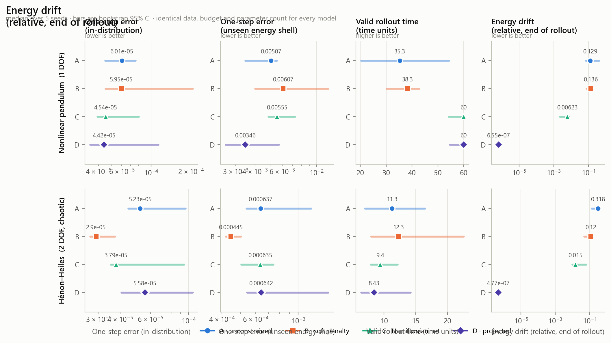
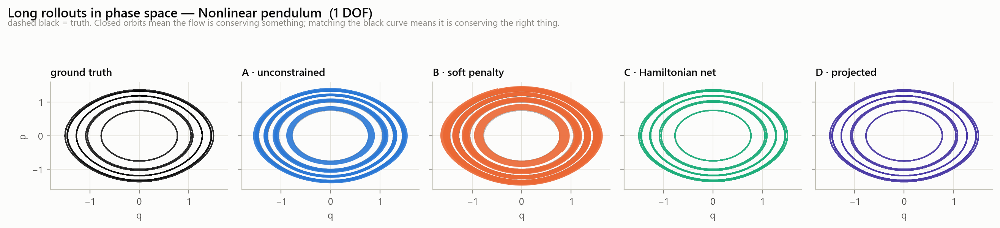
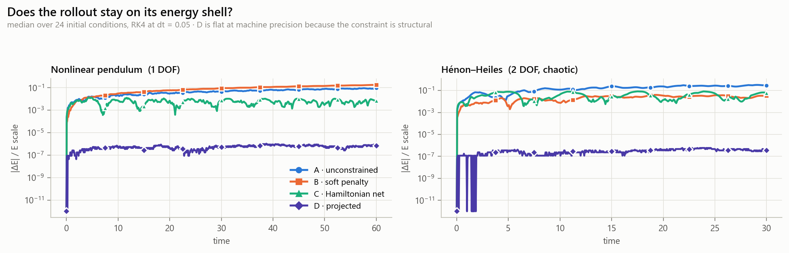
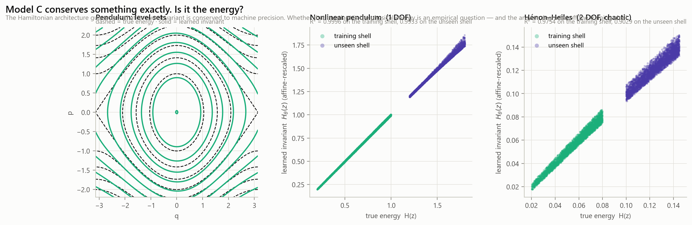
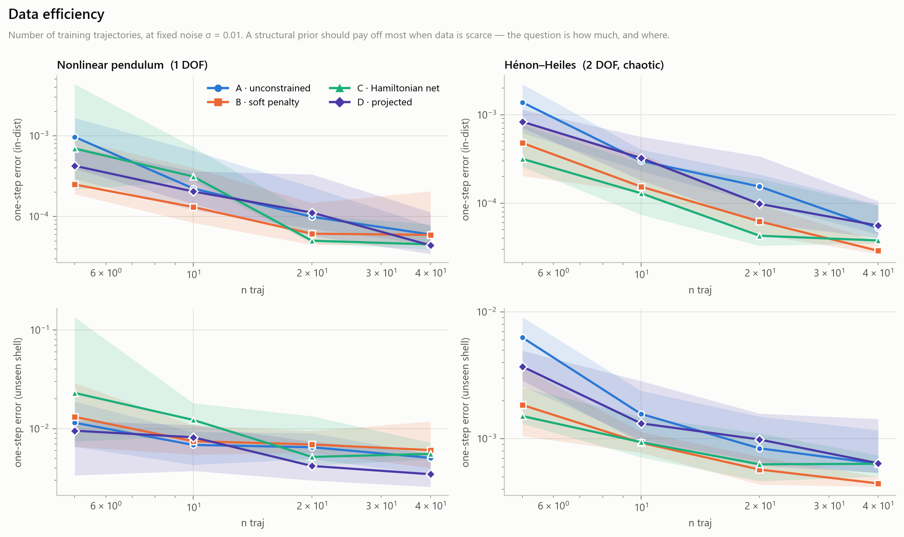
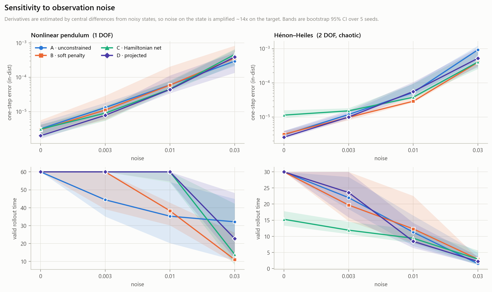
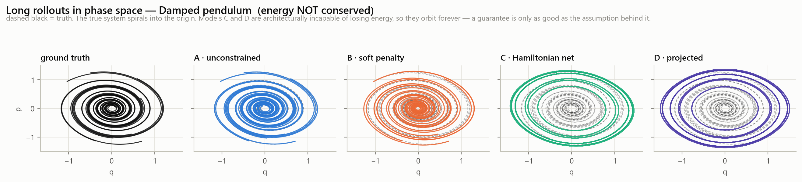
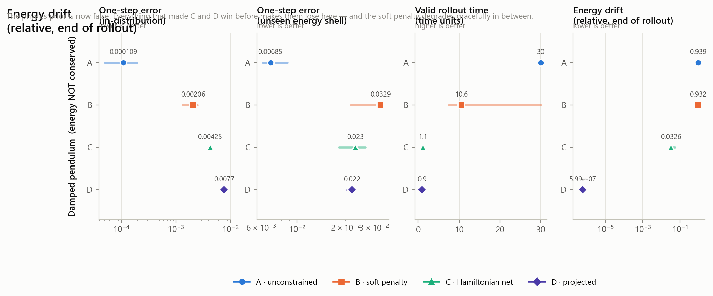
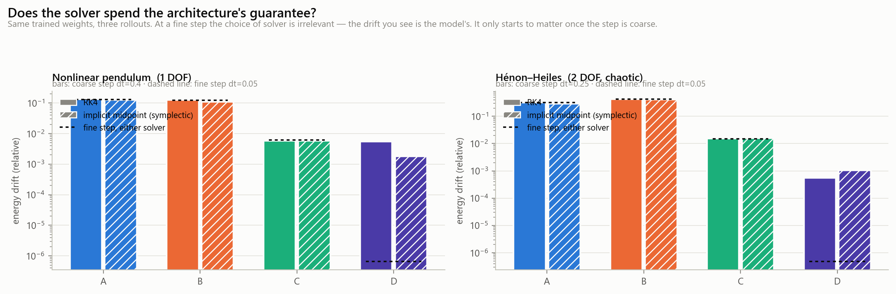
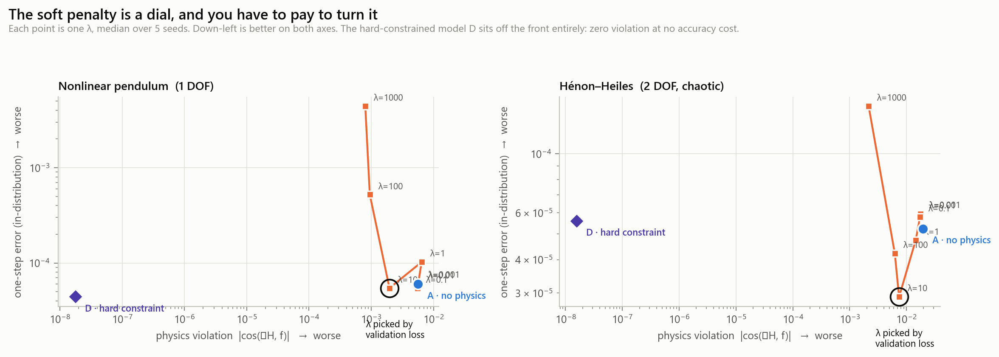

# NOT PINNs

[](tests/test_pcnn.py)
[](LICENSE)
[](pyproject.toml)
[](results/)

<!-- After pushing, replace the static tests badge above with the live one:
[](https://github.com/<owner>/<repo>/actions/workflows/tests.yml)
-->

**Everyone benchmarks *whether* to add physics to a network. This benchmarks *how* — and the choice changes the ranking more than the physics does.**

Four ways to impose one conservation law, trained on identical data with identical budgets and matched parameter counts, scored over accuracy, stability, extrapolation, noise, data efficiency, and — the part usually left out — what happens when the physics you assumed is **wrong**.

560 runs · 3 systems · 5 seeds · bootstrap CIs · 29 tests, four of which *execute* the conservation guarantees rather than asserting them in prose.



---

## The 2×2 the field collapses into a 1×2

"PINN vs baseline" merges two independent questions. Separate them and a fourth model appears:

|                          | knows the invariant *H* explicitly | knows only that *an* invariant exists |
| ------------------------ | ---------------------------------- | ------------------------------------- |
| **soft** (loss penalty)  | **B** — `L = L_data + λ·(dH/dt)²`  | *(open cell — see below)*             |
| **hard** (architecture)  | **D** — tangent projection         | **C** — Hamiltonian network           |

**A** sits outside the table: no physics at all.

Without **D**, the usual comparison pits *"penalty, with H known"* against *"architecture, with H unknown"* and credits the word **architecture** with an effect that partly belongs to the word **known**. D is what makes the comparison identify anything.

Read the bottom row carefully, because it is the finding this repo exists for. C and D both hand you an *exact* conservation law — and not of the same thing. D conserves the energy you gave it. C conserves whatever scalar its network converged to, exactly, to machine precision, **and that need not be the energy.**

| | knows | enforcement | guarantee | cost |
|---|---|---|---|---|
| **A** | nothing | — | none | — |
| **B** | `H` in closed form | loss term | approximate, λ-dependent | must tune λ |
| **C** | only the *structure* | architecture | `dH_θ/dt = 0` exactly | H_θ may not be H |
| **D** | `H` in closed form | architecture | `dH_true/dt = 0` exactly | needs H, weakens with dimension |

What that looks like as a trajectory — 60 time units from the same initial conditions, black dashed is truth:



---

## Findings

All numbers are medians over 5 seeds at the reference setting (40 trajectories, noise σ = 0.01, derivative SNR ≈ 5.3 on the pendulum and ≈ 1.2 on Hénon–Heiles). "5/5" means the model beat baseline A on all five seeds in a **paired** comparison — same data, same init, same batch order.

### 1. "Conserves energy" and "predicts the trajectory" are different axes, and they do not correlate

On Hénon–Heiles, **D** conserves energy to `4.8e-7` — six orders of magnitude better than the unconstrained baseline's `0.32` — and tracks the true trajectory **worse** (valid time 8.4 vs 11.3). Exact conservation is entirely compatible with going to the wrong place on the energy shell.

If your paper reports only energy drift, it is not reporting whether the model works.

### 2. The soft penalty barely moves the thing it exists to enforce



Pendulum, λ selected by validation loss: B cuts the instantaneous residual `|cos(∇H, f)|` by 2.3× (`5.6e-3 → 2.5e-3`) and leaves the long-horizon energy drift **unchanged** — `0.129 → 0.136`, winning on 2 of 5 seeds. The hard-constrained models move the same quantity by 3–6 orders of magnitude.

Penalising `dH/dt` at collocation points buys you a smaller pointwise residual. It does not buy conservation along a rollout.

**What the penalty *is* good for:** on Hénon–Heiles, B has the best one-step accuracy — `0.55×` the baseline's error, 5/5 seeds, and the only model whose confidence interval separates from A's (C also wins 5/5, at `0.71×`, but its interval overlaps) — and the best extrapolation error of any model (`4.4e-4` vs `6.4e-4`). Against noisy finite-difference targets the residual acts as a regulariser. That is a real benefit, and it is not the benefit it is usually sold for.

### 3. A hard constraint is worth what its codimension is worth

The projection removes **one direction out of d**.

- **d = 2** (pendulum): one free direction left. D can essentially only learn a speed along the true flow. It hits the rollout-horizon cap — `+55%` valid time over baseline, 5/5 seeds (C: `+70%`, 5/5).
- **d = 4** (Hénon–Heiles): three free directions survive, the prior is weak, and D **loses** to the unconstrained baseline (`0.83×` valid time, 2/5 seeds).

The pendulum flatters hard constraints in a way that does not survive one extra degree of freedom. Any single-pendulum demo showing a structural prior winning is showing you `d = 2`.

### 4. Model C conserves something exactly. It is not quite the energy.



C's guarantee is structural, so it holds at machine precision at every noise level and every dataset size. What the guarantee is *about* degrades:

| R² of `H_θ` vs true energy | σ=0 | σ=0.003 | σ=0.01 | σ=0.03 |
|---|---|---|---|---|
| Hénon–Heiles | 0.99975 | 0.99914 | 0.99577 | **0.936** |

and `0.906` with only 5 training trajectories. Measured against the **true** energy, C's residual on Hénon–Heiles (`1.1e-2`) is no better than the unconstrained baseline's (`1.9e-2`) and worse than the tuned penalty's (`7.4e-3`).

Subtract the best affine fit and what remains is *structured*, not noise — the learned invariant is a genuinely different function of state, and the disagreement grows off the training shell.

**"Exactly conserved" and "conserves the right thing" are different claims.** Only one of them is free.

### 5. The structural prior is a small-data effect — it evaporates, then reverses



Hénon–Heiles valid time, C vs A: **2.4 vs 1.7** at 5 trajectories, **6.2 vs 3.1** at 10, **10.9 vs 5.5** at 20 — then **9.4 vs 11.3** at 40. Extrapolation error tells the same story: 4.2× better at n=5, identical at n=40.

Report a structural prior's win without a data-size axis and you have reported where you happened to stand on this curve.

### 6. Noise is where the constraints earn their keep — but only on the hard system



Targets come from central differences on noisy states, so σ on the state becomes ≈14σ on the target. At σ = 0.03 the Hénon–Heiles targets carry **more noise than signal** (SNR 0.4). There:

| Hénon–Heiles, σ = 0.03 | A | B | C | D |
|---|---|---|---|---|
| one-step error | 9.3e-4 | **4.0e-4** | 4.1e-4 | 5.2e-4 |
| energy drift | **3.78** | 0.48 | 0.046 | 4.5e-7 |

A does not merely degrade — it invents nearly four times the initial energy. C stays 82× closer to physical.

Now the same noise level on the pendulum: **A is the most accurate model** (`2.9e-4` vs C's `4.6e-4`) and holds the longest valid rollout (32.2 vs C's 14.0). And with *clean* data on Hénon–Heiles, C is the **worst** model in the study — valid time 15.3 against 30.0 for every other model.

The constraint pays when the data is bad **and** the system is hard. Neither condition alone is enough, and outside that corner you are paying for a bias you do not need.

### 7. When the assumed law is false, the ranking inverts and the metric flips sign



Damped pendulum, α = 0.15. Same protocol, same four models, still told to conserve the undamped energy. The true system dissipates **~99%** of each trajectory's initial energy over the horizon; on the drift metric below, the truth itself scores **≈ 0.94** (median over seeds, 0.86–1.01) — which is exactly what A reproduces.

| | A | B | C | D |
|---|---|---|---|---|
| energy "drift" (truth ≈ 0.94) | **0.94** | 0.93 | 0.033 | 6e-7 |
| valid time (horizon 30) | **30.0** | 10.6 | 1.1 | 0.9 |
| one-step error | **1.1e-4** | 2.1e-3 | 4.3e-3 | 7.7e-3 |



D's perfect score on the conservation metric *is* its failure: reality drifts and D cannot. A 33× collapse in valid time, and the column that made D look best in every other experiment now identifies it as the worst model in the study.

The soft penalty is the only one that degrades gracefully — λ is a dial between "fit the data" and "believe the physics", and B lands in between. A hard constraint has no dial.

### 8. Negative result: we could not reproduce "you need a symplectic integrator"



Same trained weights, rolled out with RK4 and with implicit midpoint (symplectic for any Hamiltonian field, unlike leapfrog, which needs a separable H — a learned H is not separable).

At the fine step (dt = 0.05), for A, B and C the solver changes energy drift by **about 1%**; at the coarse step, by up to 16% (B on the pendulum) — still far below the gaps between models. The drift is model error, not solver error. Only D is precise enough for the solver to be visible at all, and there **RK4 at dt=0.05 (`6.5e-7`) beats implicit midpoint (`2.4e-5`)**. (B in this study is fixed at λ = 1, not tuned.)

*Why midpoint loses for D:* implicit midpoint is symplectic but only second-order. For a non-quadratic `H` (the pendulum's `1 − cos q`) it keeps the energy error *bounded*, not zero, at O(dt²); RK4 is fourth-order. We checked that this is truncation, not an unconverged solve: 12 and 40 fixed-point iterations give the same drift to every printed digit, and halving dt divides it by ~4. A Newton solve would not change it.

### 9. The λ front, and why D is not on it



Sweeping λ ∈ [1e-3, 1e3] on the pendulum: at λ=1000 the penalty reaches a residual of `8.0e-4` — and pays `4.4e-3` one-step error, **72×** worse than at λ=0.01. D reaches a residual of `1.8e-8` — 44 000× smaller — at `4.4e-5` error, i.e. no accuracy cost at all.

There is no λ that buys what the architecture buys. On Hénon–Heiles the front is friendlier (λ=10 improves accuracy *and* residual simultaneously), which is exactly why one system is not a benchmark.

---

## So which one should you use?

The study's whole point is that there is no single answer. This is the answer conditioned on what you actually have:

| Your situation | Use | What the evidence says |
|---|---|---|
| Plenty of clean data, you want raw accuracy | **D** if you have `H`, else **A** | At σ=0, D beats A on one-step error on 5/5 seeds on both systems (`0.66×` pendulum, `0.84×` Hénon–Heiles). C is the *worst* model on clean Hénon–Heiles (valid time 15.3 vs 30.0). |
| Noisy targets, you want accuracy | **B** | On Hénon–Heiles, the only model that beats A on 5/5 seeds at every noise level ≥ 0.003 (`0.45–0.81×` error). The residual works as a regulariser. On the pendulum, no model helps. |
| Scarce data (≲ 20 trajectories) | **C** | 4.3× more accurate than baseline at n=5. Real, and it shrinks fast — recheck at your actual data size. |
| You need the **physical** energy conserved — a downstream solver, a safety envelope, a very long simulation | **D** | Exact to `~5e-7` (the float32 floor), 6 orders better than baseline, with one-step error on par with A. But conservation is not accuracy: on Hénon–Heiles D tracks the trajectory *worse* than A (`0.83×` valid time, finding 1). Requires `H` in closed form. |
| You need *some* long-term invariant and don't know `H` | **C** | Exact conservation of a learned invariant, ~21× less drift than A on both systems. Expect R² ≈ 0.94–0.99 against the true energy — worse when noisy. |
| You are not certain the conservation law actually holds | **B**, small λ | Hard constraints collapse 33× on the misspecified system. λ is the only hedge available. |
| Your state is high-dimensional (d ≫ 2) | temper expectations | The constraint removes 1 direction out of d. At d = 4 it has already stopped paying. |

The one recommendation that holds everywhere: **report a trajectory metric next to your conservation metric.** Finding 1 is that they can point in opposite directions, and finding 7 is that the conservation metric can be maximally wrong while looking perfect.

---

## What makes this comparison worth believing

The claims above are only as good as the controls. These are enforced in code, not assumed:

- **No exact derivatives, anywhere.** We observe a noisy trajectory and estimate `dz/dt` by central differences, amplifying state noise by `1/(√2·dt) ≈ 14`. Handing models analytic derivatives — the usual demo setup — removes the regime where a physics prior is supposed to earn its keep.
- **Model B is tuned, not strawmanned.** Every B entry is trained at three λ values and the one with the best **validation** loss wins — validation on the *noisy* targets, the only signal a practitioner has. Tuning on clean data would leak the answer into a study about noise.
- **Budget in optimizer steps, not epochs**, so a cheaper forward pass does not silently earn extra updates.
- **Matched parameter counts to <1%**, solved for rather than hoped for, and asserted in `tests/test_pcnn.py::test_parameter_budgets_match`.
- **Train/test split by energy shell, not by bounding box.** A box split lets a model interpolate across the boundary; "extrapolation" then means nothing.
- **Paired seeds.** All four models see identical data, initial conditions, batch order and init for a given seed, so seed variance cancels and 5 seeds can detect a consistent effect.
- **The guarantees are tested, not claimed.** `test_model_C_conserves_its_own_invariant_exactly`, `test_model_D_conserves_the_true_energy_exactly`, and — so those are not vacuous — `test_unconstrained_model_does_not_conserve`.
- **The reported residual is normalised** (`|cos(∇H, f)|`), not the raw penalty, because the raw penalty `(∇H·f)²` is minimised by a network predicting `f ≈ 0`: perfectly "physics-consistent" and perfectly useless. The raw form is only used as B's training loss.
- **The figure palette is validated, not eyeballed** — `scripts/validate_palette.py` runs the OKLab separation and dichromat-simulation gates in CI.

Full protocol, including every constant: **[docs/PROTOCOL.md](docs/PROTOCOL.md)**. Long-form results with confidence intervals: **[FINDINGS.md](FINDINGS.md)**.

## What this does *not* show

- **Two dimensionalities (d = 2, d = 4).** The codimension argument in finding 3 is supported at two points, not demonstrated as a law.
- **One invariant per system.** Nothing here about multiple, non-holonomic, or approximate constraints.
- **Neural-ODE setting, not PDE-PINN.** Models learn a vector field, not a space-time solution field. Conclusions transfer to operator learning by analogy, not by proof. The choice is defended in the protocol.
- **5 seeds** detect consistent effects, not small ones. Where intervals overlap, FINDINGS.md says so rather than ranking.
- **λ tuned over three values**, not continuously, outside the dedicated sweep.

## Reproduce

```bash
pip install -e ".[dev]"

pytest -q                                    # 29 tests (~10 s), incl. the guarantees
python scripts/demo.py                       # 60 s: all four models, one system, one table
python scripts/run_experiments.py --quick    # ~5 min reduced grid
make grid SHARDS=8                           # the full 560-run study (~30 min on 8 cores)
python scripts/make_figures.py               # every figure from results/
```

The grid is sharded, append-only and resumable — re-running a shard skips what is already recorded, as long as you keep the same number of shards (the committed results used 20; a different count reassigns jobs and recomputes them). Raw per-run records are committed in `results/raw_shard*.jsonl`, so every number above can be recomputed without rerunning anything.

### Your numbers will differ in the last digits — and why

Everything is seeded, and on one machine a rerun is bit-for-bit identical (we checked this, with 1 and 4 threads). **Across machines it is not**, and that is expected, not a bug:

- **Floating-point addition is not associative.** A matrix product is a long sum, and the order of that sum depends on the CPU's vector instructions (SSE / AVX2 / AVX-512), the BLAS library (MKL, OpenBLAS, Accelerate), and the PyTorch version. Different order → different rounding in the last bit.
- **Training amplifies the last bit.** 4000 steps of a nonlinear optimiser turn a 1e-8 difference in one gradient into a slightly different set of weights.
- **Chaos amplifies it further.** Hénon–Heiles rollouts separate exponentially, so valid times on that system are the most sensitive quantity in the study.
- **Some numbers *are* the rounding.** D's energy drift (~5e-7) is the float32 round-off floor, not a property of the model; it will move by tens of percent between machines.

Concretely, rerunning four recorded jobs with MKL forced onto a different instruction set (`MKL_CBWR=SSE4_2`, standing in for an older CPU) changed losses and one-step errors by 1e-7 to 4e-6 relative, left valid times unchanged, and moved D's drift from `6.5e-7` to `1.1e-6`. Expect the same order of variation, more on GPU. **What should reproduce is every comparison in this README** — the rankings, the 5/5 counts, the orders of magnitude — because they are effects of 1.5× to 10⁶×, against machine noise of 10⁻⁶. If a conclusion here flips on your machine, that is a finding, and worth an issue.

The committed results were produced with PyTorch 2.7.1 on CPU (x86-64, AVX-512, MKL), one thread per shard.

## The open cell

The 2×2 has a fourth square: **a soft penalty on a *learned* invariant** — an auxiliary head proposes `Ĥ`, the loss penalises `∇Ĥ·f`. It would test whether the softness or the explicitness is what makes B degrade gracefully under misspecification. It is not implemented (it adds an unstable inner loop to tune, and this study is about clean attribution). PRs welcome — the harness takes a new model in about 20 lines: subclass `PhysicsModel`, register it in `pcnn/models.py::MODELS`, and it enters every experiment automatically.

## Layout

```
pcnn/
  systems.py      pendulum · Hénon–Heiles · damped pendulum (NumPy + Torch sides, cross-tested)
  models.py       the four models, and the taxonomy they instantiate
  data.py         noisy trajectories → finite-difference targets → energy-shell splits
  train.py        one loop, four models, enforced-identical budget
  losses.py       the physics residual, raw and normalised
  metrics.py      error · valid time · energy drift · residual · learned-invariant R²
  integrators.py  DOP853 reference · RK4 · implicit midpoint
  experiments.py  the 560-job grid, in one place
  analysis.py     λ selection, medians, bootstrap CIs, paired tests
  plotting.py     figures (palette validated for CVD)
scripts/          run_experiments · make_figures · demo · validate_palette
tests/            29 tests, incl. the executable guarantees
results/          raw JSONL (committed) + aggregated CSVs
docs/PROTOCOL.md  every constant and every judgement call
CONVERSATION.md   the original brief and the design log (in French)
transcript/       the session the project was built in
```

## Citing

See [CITATION.cff](CITATION.cff).

## License

MIT.
